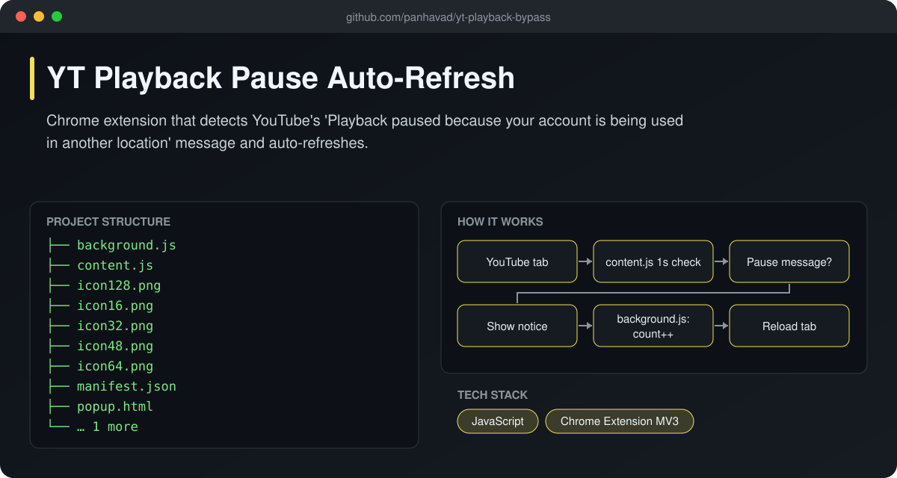
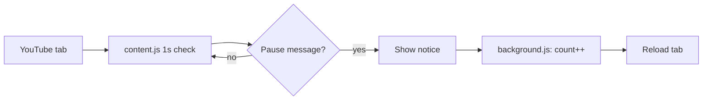

# YT Playback Pause Auto-Refresh

  [](https://github.com/panhavad/yt-playback-bypass/releases/latest)

A small **Chrome extension for YouTube** that watches for the *"Playback paused because your account is being used in another location"* message and automatically refreshes the page, with an on-screen notice and a counter in the popup.



## Features

- Scans the page once per second
- Shows a toast before refreshing
- Counts how many times it kicked in (popup)
- Manifest V3 service worker + storage

## How it works



## Getting started

1. Download the release zip and unzip it.
2. Open `chrome://extensions`, enable **Developer mode**.
3. **Load unpacked** and select the folder.

## Download

Grab the packaged source from the [latest release](https://github.com/panhavad/yt-playback-bypass/releases/latest).

## Tech stack

- JavaScript
- Chrome Extension MV3

## Project structure

```text
yt-playback-bypass/
├── docs/
├── background.js
├── content.js
├── icon128.png
├── icon16.png
├── icon32.png
├── icon48.png
├── icon64.png
├── manifest.json
├── popup.html
├── popup.js
└── README.md
```
